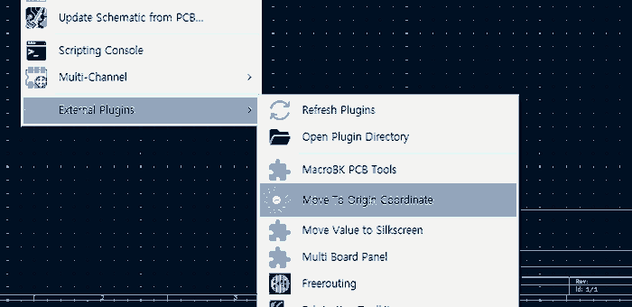
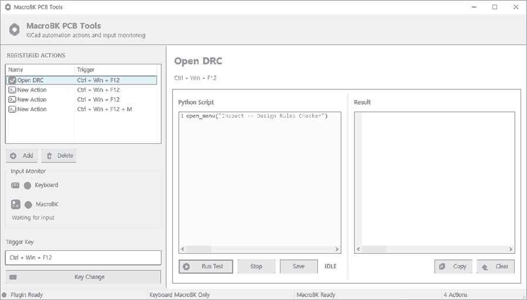
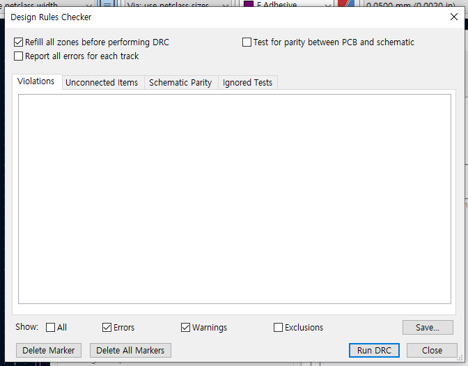
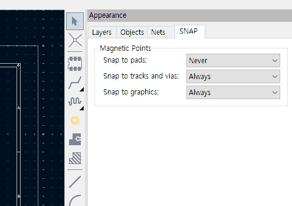

# MacroBK KiCAD Tools

**언어 / Language:** [English](README.md) | **한국어**

**KiCad 9 PCB Editor용 Python 자동화 플러그인**  
개발: **BK Systems** · 라이선스: [MIT](LICENSE) · [GitHub 저장소](https://github.com/rco123/macrobk-kicad-tools)

KiCad PCB Editor에서 사용하는 기능을 **Python Script**로 작성한 다음 **Run Test**, 키보드 단축키 또는 **MacroBK 트리거**로 실행할 수 있습니다. DRC 창 열기, 레이어 변경, 선택 필터, 트랙 폭, SNAP 설정 등을 지원합니다.

> 이 README는 **사용자를 위한 사용설명서**입니다. 새로운 자동화 활용 사례는 아래 **[사용 사례 예제](#6-사용-사례-예제)**에 계속 추가할 예정입니다.

## 목차

1. [설치 및 플러그인 실행](#1-설치-및-플러그인-실행)
2. [메인 화면과 버튼 설명](#2-메인-화면과-버튼-설명)
3. [Action과 Python Script 작성 방법](#3-action과-python-script-작성-방법)
4. [DRC 검사 창 열기](#4-drc-검사-창-열기)
5. [SNAP 설정](#5-snap-설정)
6. [사용 사례 예제](#6-사용-사례-예제)
7. [사용자가 호출하는 함수](#7-사용자가-호출하는-함수)
8. [문제 해결 및 주의사항](#8-문제-해결-및-주의사항)

## 1. 설치 및 플러그인 실행

**대상 환경:** Windows의 KiCad 9 PCB Editor

1. 이 저장소를 내려받거나 Git으로 복제합니다.
2. 소스 파일과 `icons` 폴더 전체가 다음 위치에 있도록 설치합니다.

   ```text
   %USERPROFILE%\Documents\KiCad\9.0\scripting\plugins\macrobk_drc_bridge\
   ```

   Git으로 설치한다면 다음처럼 폴더명을 지정할 수 있습니다.

   ```powershell
   cd "$env:USERPROFILE\Documents\KiCad\9.0\scripting\plugins"
   git clone https://github.com/rco123/macrobk-kicad-tools.git macrobk_drc_bridge
   ```

3. **KiCad PCB Editor를 완전히 종료한 뒤 다시 실행**합니다.
4. 메뉴에서 **Tools → External Plugins → MacroBK KiCAD Tools**를 선택합니다.



**업데이트할 때:** 기존에 등록한 Action과 Script는 플러그인 폴더의 `config.json`에 저장됩니다. 업데이트 전에 이 파일을 별도로 백업하세요. GitHub의 `config.example.json`은 설명용 예시이며 기존 설정을 대신하지 않습니다.

## 2. 메인 화면과 버튼 설명



| 화면 영역 | 기능과 사용 방법 |
| --- | --- |
| **Registered Actions** | 저장할 자동화 항목 목록. 항목을 선택하고 **Add**로 추가하거나 **Delete**로 삭제. **이름을 더블클릭**하면 이름 변경 |
| **Input Monitor** | **Keyboard**, **MacroBK** 중 어느 경로에서 트리거 입력이 수신되었는지 표시등으로 확인 |
| **Trigger Key** | 선택한 Action에 할당된 키 조합 표시 |
| **Key Change** | 키 선택 창을 열어 Trigger 수정. 창 안의 **Apply**로 즉시 적용, **Cancel**로 취소 |
| **Python Script** | Action 실행 시 사용할 Python 코드 입력 |
| **Run Test / Stop / Save** | 실행 테스트 / 실행 중지 요청 / Action 저장 |
| **Result** | `print()` 출력 및 스크립트 오류 확인. **Copy**로 복사, **Clear**로 지우기 |

**실행 상태**는 Python Script 아래 버튼 옆에 `IDLE`, `RUNNING`, `SUCCESS`, `ERROR`, `STOPPING` 등으로 표시됩니다. Python Script와 Result 사이의 구분선은 마우스로 드래그하여 너비를 조절할 수 있습니다.

### 2.1 Registered Actions

- **Add:** 이름이 `New Action`이고 기본 키가 `Ctrl + Win + F12`인 새 항목을 만듭니다. Python Script에는 안내 주석이 들어 있습니다.
- **이름 변경:** 변경할 항목을 더블클릭합니다.
- **Delete:** 선택한 항목을 삭제합니다. 삭제 전에 확인 창이 표시됩니다.
- 동일한 이름을 사용해도 각 Action은 별도로 저장되지만, 구별하기 쉬운 이름을 권장합니다.

### 2.2 Input Monitor

- **Keyboard:** 플러그인이 처리한 키보드 트리거 입력이 들어오면 표시등이 반응합니다.
- **MacroBK:** MacroBK 트리거 메시지가 들어오면 표시등이 반응합니다.
- **Waiting for input:** 입력 대기 중이라는 뜻입니다.

`MacroBK Ready`는 메시지를 **수신할 준비가 되었다**는 상태이지, 장치가 실제로 연결되었음을 보장하는 표시는 아닙니다. 일반적인 모든 키 입력이 아니라 **등록된 트리거**에 반응합니다.

### 2.3 Key Change

1. Registered Actions에서 변경할 Action을 선택합니다.
2. **Key Change**를 누릅니다.
3. Ctrl / Alt / Shift / Win 및 일반 키를 선택합니다.
4. **Apply**를 누르면 키가 즉시 저장·갱신됩니다. **Cancel**은 변경 없이 닫습니다.

키보드 단축키는 수정키와 일반 키 **한 개** 조합을 지원합니다. 일반 키를 2~4개 함께 선택한 조합은 **MacroBK 입력 전용**입니다. 동일한 Trigger가 여러 Action에 할당된 경우, **MacroBK 입력은 목록에서 가장 위에 있는 활성 Action 하나**를 실행합니다.

## 3. Action과 Python Script 작성 방법

1. **Add**를 눌러 새 Action을 만듭니다.
2. 목록 항목을 더블클릭해 `New Action`을 원하는 이름으로 변경합니다.
3. **Python Script** 영역에 필요한 코드를 입력합니다.
4. **Run Test**를 눌러 동작과 Result 출력을 확인합니다.
5. 문제가 없으면 **Save**로 Action과 스크립트를 저장합니다.
6. 필요한 경우 **Key Change → Apply**로 Trigger를 설정합니다.

예를 들어 현재 PCB 레이어를 알아보려면 다음과 같이 작성합니다.

```python
print(pcb_get_selected_layer())
```

**Run Test**를 누르면 Result에 `F.Cu`, `B.Cu` 등의 현재 레이어 이름이 표시됩니다. 아래 [함수 목록](#7-사용자가-호출하는-함수)에 있는 함수는 **별도의 import 없이** Python Script에서 직접 호출할 수 있습니다.

| 버튼 | 의미 |
| --- | --- |
| **Run Test** | 작성 중인 Python Script 즉시 실행 |
| **Stop** | 실행 중인 Script에 중지 요청 |
| **Save** | 현재 Action과 Script 저장 |
| **Copy / Clear** | Result 출력 복사 / 지우기 |

> **Stop**은 강제 종료 버튼이 아닙니다. 이미 실행된 KiCad 메뉴 명령이나 열린 창을 자동으로 취소하지는 않습니다.

## 4. DRC 검사 창 열기

PCB 설계 규칙 검사를 실행할 때 사용하는 기본 예제입니다.

### 4.1 Python Script 입력 및 Run Test

1. `Open DRC` Action을 선택하거나 새 Action을 만듭니다.
2. Python Script에 다음 코드를 입력합니다.

   ```python
   open_menu("Inspect -> Design Rules Checker")
   ```

3. **Run Test**를 누릅니다.
4. **Design Rules Checker** 창이 열리면 메뉴 호출이 정상 동작한 것입니다.

### 4.2 DRC 검사 실행



1. DRC 창에서 검사 옵션을 확인합니다.
2. 오른쪽 아래 **Run DRC** 버튼을 누릅니다.
3. `Violations`, `Unconnected Items` 등 결과 탭에서 내용을 확인합니다.
4. 검사를 마친 뒤 창을 닫습니다.

**중요:** `open_menu("Inspect -> Design Rules Checker")`는 **DRC 창만 여는 코드**입니다. 실제 검사는 창 안에서 **Run DRC**를 눌러 시작합니다. KiCad 메뉴 언어가 다른 경우 실제 표시된 메뉴명에 맞춰 경로 문자열을 변경해야 합니다.

## 5. SNAP 설정

PCB Editor 오른쪽의 **Appearance → SNAP** 탭에서 Magnetic Points(자석 스냅) 설정을 확인할 수 있습니다.



| 화면 항목 | Script 파라미터 | 사용할 수 있는 값 |
| --- | --- | --- |
| **Snap to pads** | `pads` | `Never`, `When routing tracks`, `Always` |
| **Snap to tracks and vias** | `tracks_vias` | `Never`, `When routing tracks`, `Always` |
| **Snap to graphics** | `graphics` | `Never`, `Always` |

현재 상태 확인:

```python
print(pcb_get_snap_settings())
```

설정 변경:

```python
pcb_set_snap_settings(
    pads="Always",
    tracks_vias="When routing tracks",
    graphics="Never"
)
```

변경하지 않을 항목은 생략할 수 있습니다. 예를 들어 `pcb_set_snap_settings(pads="Always")`는 Pads 설정만 변경합니다.

> SNAP을 처음 사용하기 전 KiCad 설정을 백업하거나 기존 값을 기록하고, 한 항목씩 변경하여 확인하는 것을 권장합니다.

## 6. 사용 사례 예제

새 활용 사례가 나오면 **이 절에 번호를 이어서 추가**합니다. 각 예제는 **사용 목적 → 코드 → 확인 방법** 순서로 정리합니다.

### 예제 1. 현재 레이어 확인 및 변경

현재 선택된 레이어를 출력합니다.

```python
print(pcb_get_selected_layer())
```

앞면 구리층으로 이동:

```python
pcb_select_layer("F.Cu")
```

뒷면 구리층으로 이동:

```python
pcb_select_layer("B.Cu")
```

### 예제 2. 레이어 표시 / 숨기기

`B.SilkS` 레이어를 숨기고 다시 표시합니다.

```python
pcb_onoff_layer("B.SilkS", False)  # 숨기기
pcb_onoff_layer("B.SilkS", True)   # 표시
```

### 예제 3. 선택된 트랙 폭 변경

PCB Editor에서 폭을 변경할 **트랙 세그먼트를 먼저 선택**합니다.

```python
changed = pcb_set_selected_track_width(0.30)
print("Changed tracks:", changed)
```

선택된 트랙의 폭을 `0.30 mm`로 변경하고 변경 개수를 출력합니다.

### 예제 4. 라우팅 폭 변경과 기본값 복귀

현재 라우팅 폭을 `0.40 mm`로 설정합니다.

```python
pcb_set_routing_track_width(0.40)
```

Netclass 폭을 다시 사용하려면 다음 코드를 실행합니다.

```python
pcb_set_netclass_track_width()
```

이 기능은 기존에 그려진 트랙 전체의 폭을 변경하는 기능은 아닙니다.

### 예제 5. 선택 필터 변경

트랙 선택을 끄고, 다시 켭니다.

```python
pcb_select_filter("Tracks", False)
pcb_select_filter("Tracks", True)
```

전체 선택 필터 설정을 출력합니다.

```python
print(pcb_select_filter_state())
```

### 예제 6. SNAP 항목 하나만 변경

```python
pcb_set_snap_settings(pads="Always")
print(pcb_get_snap_settings())
```

## 7. 사용자가 호출하는 함수

아래는 **Python Script에서 실제로 사용할 수 있는 함수**만 정리한 목록입니다. 괄호 안의 문자열·숫자는 필요한 값으로 바꾸어 사용합니다.

### 7.1 메뉴 실행

| 함수 | 파라미터 | 역할 |
| --- | --- | --- |
| `open_menu(path)` | `path`: KiCad 메뉴 경로 문자열 | 메뉴 명령을 실행하고 성공 여부(`bool`) 반환 |

```python
open_menu("Inspect -> Design Rules Checker")
```

### 7.2 레이어

| 함수 | 파라미터 | 역할 |
| --- | --- | --- |
| `pcb_select_layer(name)` | `name`: 레이어명, 예: `"F.Cu"` | 해당 레이어 선택 |
| `pcb_get_selected_layer()` | 없음 | 현재 레이어명 반환 |
| `pcb_onoff_layer(name, value=None)` | `name`: 레이어명, `value`: `True` 표시 / `False` 숨김 / 생략 시 조회 | 레이어 표시 상태 확인·변경 |
| `pcb_layer_up()` | 없음 | 이전 활성 구리 레이어로 이동 |
| `pcb_layer_down()` | 없음 | 다음 활성 구리 레이어로 이동 |

### 7.3 선택 필터

| 함수 | 파라미터 | 역할 |
| --- | --- | --- |
| `pcb_select_filter(name, value=None)` | `name`: 항목명, `value`: `True` 활성 / `False` 비활성 / 생략 시 조회 | 선택 필터 확인·변경 |
| `pcb_select_filter_state()` | 없음 | 모든 선택 필터 상태 조회 |

사용 가능한 항목 이름: `All items`, `Locked items`, `Footprints`, `Text`, `Tracks`, `Vias`, `Pads`, `Graphics`, `Zones`, `Rule Areas`, `Dimensions`, `Other items`.

### 7.4 트랙 폭

| 함수 | 파라미터 | 역할 |
| --- | --- | --- |
| `pcb_set_selected_track_width(width_mm)` | `width_mm`: 양수(mm) | **선택된 트랙 세그먼트** 폭 변경, 변경 개수 반환 |
| `pcb_set_routing_track_width(width_mm)` | `width_mm`: 양수(mm) | 앞으로 사용할 라우팅 폭 지정 |
| `pcb_set_netclass_track_width()` | 없음 | Netclass 기본 라우팅 폭 사용 |

### 7.5 SNAP

| 함수 | 파라미터 | 역할 |
| --- | --- | --- |
| `pcb_get_snap_settings(include_choices=False)` | `include_choices=True`로 가능한 값도 조회 | 현재 SNAP 값 조회 |
| `pcb_set_snap_settings(pads=None, tracks_vias=None, graphics=None)` | 변경할 항목에 설정 문자열 입력, 나머지는 생략 가능 | SNAP 값 변경 및 결과 반환 |

설정값은 [SNAP 설정표](#5-snap-설정)를 참고하세요.

### 7.6 스크립트 중지 확인

| 함수 | 파라미터 | 역할 |
| --- | --- | --- |
| `stop_requested()` | 없음 | Stop 요청 여부 반환 |
| `wait_or_stop(seconds)` | `seconds`: 대기 시간(초) | 대기 중 Stop이 요청되면 `True` 반환 |

반복 작업은 다음처럼 중지 요청을 확인할 수 있습니다.

```python
for n in range(10):
    if wait_or_stop(0.5):
        break
    print(n)
```

## 8. 문제 해결 및 주의사항

- **플러그인이 보이지 않음:** 설치 경로와 폴더 구조를 확인하고 PCB Editor를 완전히 종료한 후 다시 실행합니다.
- **DRC 창만 열리고 검사는 안 됨:** DRC 창에서 **Run DRC**를 눌러야 합니다.
- **`open_menu()` 동작 안 함:** 실제 KiCad 메뉴의 언어와 경로가 Script 문자열과 일치하는지 확인합니다.
- **키보드 Trigger가 동작하지 않음:** Windows 키 조합 중복 또는 일반 키 2개 이상 선택 여부를 확인합니다. 여러 일반 키 조합은 MacroBK 입력용입니다.
- **MacroBK가 Ready인데 입력이 없음:** Ready는 수신 대기 상태이며 장치 연결을 의미하지 않습니다. 장치/Studio에서 설정한 Trigger가 전달되는지 확인합니다.
- **Stop이 즉시 멈추지 않음:** Stop은 중지 요청이며 이미 실행한 KiCad 명령과 대화상자를 강제 종료하지 않습니다.
- **저장했던 Action을 찾지 못함:** 업데이트 전에 백업한 `config.json`을 확인합니다.
- **기존 `open_drc_window()`가 오류를 냄:** 해당 함수는 제거되었으므로 `open_menu("Inspect -> Design Rules Checker")`를 사용합니다.

Python Script는 사용자 PC에서 실행됩니다. **신뢰할 수 있는 코드만 사용**하고, PCB나 환경 설정을 변경하기 전에 프로젝트를 저장하거나 백업한 후 시험하세요.

---

**Copyright © 2026 BK Systems.** [MIT License](LICENSE).  
KiCad 및 외부 라이브러리의 저작권과 라이선스는 각각의 소유자에게 있습니다. 이 플러그인은 KiCad 공식 프로젝트의 인증 제품이 아닙니다.